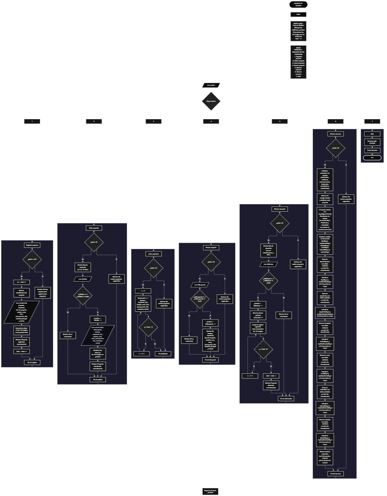

Este proyecto, llamado <b>arquitecto de ciudades</b>, fue desarrollado en <b>java</b> como un ejercicio práctico para fortalecer la lógica de programación mediante la creación de un sistema de gestión de proyectos arquitectónicos desde la consola. El programa cuenta con un menú principal de siete opciones que permite <b>registrar, editar, listar, buscar, eliminar y consultar información estadística</b> de los proyectos registrados. Cada proyecto almacena datos como el nombre, el arquitecto, el tipo de proyecto, la ciudad, la zona, el área, el presupuesto, el año, el material principal y el estado, utilizando arreglos con una capacidad máxima de <b>10 proyectos durante la ejecución</b>. Durante su desarrollo se aplicaron conceptos fundamentales de programación, como variables, arreglos, estructuras condicionales, ciclos repetitivos y estructuras de selección, además de procesos para buscar, modificar, eliminar, organizar registros y realizar análisis estadísticos. Este proyecto permite poner en práctica los conocimientos adquiridos en Java y sirve como base para desarrollar sistemas de gestión más avanzados utilizando otros lenguajes y tecnologías.

<h2 align="center">⚙️ Funcionamiento del menú principal</h2>

### ➕ Registrar proyecto

La opción <b>1) registrar proyecto</b> permite almacenar un nuevo proyecto arquitectónico en el sistema. Antes de realizar el registro, el programa comprueba que la cantidad de proyectos almacenados sea menor a la capacidad máxima de los arreglos, utilizando la condición <b>total &gt;= nombresProyectos.length</b> para determinar si ya no existe espacio disponible. Si hay espacio, asigna un identificador mediante la variable <b>id</b>, calculado a partir de la cantidad de registros existentes más uno, y solicita el <b>nombre del proyecto, arquitecto, tipo de proyecto, ciudad, zona, área, presupuesto, año, material principal y estado</b>. Los datos se almacenan en la posición correspondiente de sus respectivos arreglos. Finalmente, muestra el mensaje <b>"Proyecto registrado correctamente."</b> y aumenta la variable <b>total</b> en uno. Si se alcanza la capacidad máxima, presenta el mensaje <b>"No hay espacio para registrar mas proyectos."</b>, impidiendo agregar otro proyecto.

### ✏️ Editar proyecto

La opción <b>2) editar proyecto</b> permite modificar la información de un proyecto registrado. Primero, el programa comprueba si existen proyectos almacenados mediante la variable <b>total</b>. Si no hay registros, muestra el mensaje <b>"No existen proyectos registrados."</b>. En caso contrario, presenta una lista con los identificadores y los datos de cada proyecto. Después, solicita el identificador del proyecto que se desea editar y comprueba que esté dentro del rango permitido mediante la condición <b>idEditar &gt;= 1 &amp;&amp; idEditar &lt;= total</b>. Si la selección es válida, obtiene la posición correspondiente restando uno al identificador y solicita nuevamente los diez datos del proyecto, actualizando directamente los valores de los arreglos correspondientes. Finalmente, presenta el mensaje <b>"Proyecto actualizado correctamente."</b>. Si el identificador seleccionado no corresponde a un proyecto registrado, muestra el mensaje <b>"ID no encontrada."</b>.

### 📋 Listar proyectos

La opción <b>3) listar proyectos</b> permite visualizar todos los proyectos registrados actualmente en el sistema. Antes de mostrar la información, el programa comprueba si la variable <b>total</b> es igual a cero. Si no existen registros, presenta el mensaje <b>"No existen proyectos registrados."</b>. Si hay proyectos disponibles, utiliza un ciclo <b>for</b> para recorrer los arreglos desde la primera posición hasta el número total de proyectos registrados. Durante el recorrido, muestra el identificador, el nombre del proyecto, el arquitecto, el tipo de proyecto, la ciudad, la zona, el área, el presupuesto, el año, el material principal y el estado de cada registro. Esta función facilita consultar los proyectos almacenados sin necesidad de buscar cada uno individualmente.

### 🔎 Buscar proyecto

La opción <b>4) buscar proyecto</b> permite localizar un proyecto mediante su identificador. Primero, el programa comprueba si existen proyectos registrados. Si no hay registros, muestra el mensaje <b>"No existen proyectos registrados."</b>. En caso contrario, solicita el identificador del proyecto que se desea buscar y comprueba que esté dentro del rango permitido mediante la condición <b>idBusqueda &gt;= 1 &amp;&amp; idBusqueda &lt;= total</b>. Cuando el identificador es válido, obtiene directamente la posición correspondiente restando uno al ID y muestra el nombre, arquitecto, tipo de proyecto, ciudad, zona, área, presupuesto, año, material principal y estado del proyecto seleccionado. Si el identificador no corresponde a un proyecto registrado, presenta el mensaje <b>"ID no encontrada."</b>. La búsqueda se realiza mediante el identificador y no mediante el nombre del proyecto.

### 🗑️ Eliminar proyecto

La opción <b>5) eliminar proyecto</b> permite eliminar un proyecto registrado mediante su identificador. Antes de comenzar, el programa comprueba que existan proyectos almacenados. Si no hay registros, muestra el mensaje <b>"No existen proyectos registrados."</b>. Si hay proyectos disponibles, presenta una lista con los identificadores y los datos de cada proyecto. Después, solicita el identificador del proyecto que se desea eliminar y verifica que esté dentro del rango válido. Si el proyecto existe, obtiene su posición restando uno al identificador y comienza el proceso de eliminación. Para mantener los registros organizados, utiliza un ciclo <b>for</b> que desplaza una posición hacia atrás los datos de los proyectos posteriores en los diez arreglos correspondientes. Posteriormente, disminuye la variable <b>total</b> en uno y muestra el mensaje <b>"Proyecto eliminado correctamente."</b>. Si el identificador seleccionado no corresponde a un proyecto registrado, presenta el mensaje <b>"ID no encontrada."</b>.

### 📊 Mostrar resumen

La opción <b>6) mostrar resumen</b> permite consultar información estadística de los proyectos registrados. Primero, el programa comprueba si existen proyectos almacenados. Si no hay registros, muestra el mensaje <b>"No existen proyectos registrados."</b>. En caso contrario, utiliza contadores para clasificar los proyectos según sus estados: <b>planificado, en diseño, en construcción, finalizado y cancelado</b>, además de contabilizar los estados diferentes dentro de la categoría de otros. También realiza comparaciones mediante ciclos <b>for</b> anidados para identificar el tipo de proyecto, arquitecto, ciudad, zona, material principal y estado que aparecen con mayor frecuencia. Para estas comparaciones utiliza el método <b>equalsIgnoreCase()</b>, que permite comparar los valores sin distinguir entre mayúsculas y minúsculas. Finalmente, muestra la cantidad total de proyectos, los valores que aparecen con mayor frecuencia y los conteos correspondientes a cada estado.

### 🚪 Salir del menú principal

La opción <b>7) salir</b> está destinada a finalizar la ejecución del programa. El menú principal se encuentra dentro de una estructura repetitiva <b>do-while</b>, que mantiene el sistema en funcionamiento mientras el usuario realiza las operaciones disponibles. Al seleccionar la opción correspondiente para salir, la condición del ciclo deja de cumplirse, finaliza la repetición y se cierra el objeto <b>Scanner</b> utilizado para la lectura de datos.

<h2 align="center">🧠 Temas aplicados en el proyecto</h2>

### 📦 Variables

En este proyecto se utilizan variables para guardar la opción seleccionada en el menú, controlar la cantidad de proyectos registrados, identificar la posición de los registros, almacenar los identificadores utilizados en las operaciones y realizar los conteos necesarios para el resumen estadístico. Cada variable cumple una función específica dentro de las operaciones de gestión de proyectos.

🔢 **Opcion:** Almacena la opción seleccionada por el usuario en el menú principal.

📊 **Total:** Almacena la cantidad actual de proyectos registrados.

🔎 **IdEditar:** Almacena el identificador del proyecto que se desea modificar.

🔍 **IdBusqueda:** Almacena el identificador del proyecto que se desea buscar.

🗑️ **IdEliminar:** Almacena el identificador del proyecto que se desea eliminar.

📍 **Posicion:** Permite determinar la posición del proyecto seleccionado dentro de los arreglos.

📈 **Contadores estadísticos:** Almacenan las cantidades utilizadas para identificar los estados y los valores que aparecen con mayor frecuencia.

### 🗃️ Arreglos

En este proyecto se utilizan diez arreglos paralelos relacionados con los datos de cada proyecto arquitectónico. Cada arreglo tiene una capacidad de <b>10 posiciones</b> y utiliza el mismo índice para representar la información correspondiente a un mismo proyecto. Por ejemplo, los datos de un proyecto almacenado en la posición <b>0</b> se encuentran distribuidos entre los diez arreglos en esa misma posición. Esta organización permite recorrer, buscar, modificar, mostrar y eliminar los proyectos de manera ordenada.

🏙️ **NombresProyectos[10]:** Almacena los nombres de los proyectos arquitectónicos.

👷 **Arquitectos[10]:** Almacena los nombres de los arquitectos responsables.

🏗️ **TiposProyectos[10]:** Almacena los tipos de proyectos.

🌆 **Ciudades[10]:** Almacena las ciudades donde se desarrollan los proyectos.

📍 **Zonas[10]:** Almacena las zonas de ubicación de los proyectos.

📐 **Areas[10]:** Almacena las áreas de los proyectos.

💰 **Presupuestos[10]:** Almacena los presupuestos de los proyectos.

📅 **Anos[10]:** Almacena los años correspondientes a los proyectos.

🧱 **Materiales[10]:** Almacena los materiales principales utilizados.

📊 **Estados[10]:** Almacena los estados actuales de los proyectos.

### 🔀 Estructuras condicionales

En este proyecto se utilizan las estructuras <b>if</b> y <b>else</b> para comprobar si existen proyectos registrados antes de realizar determinadas operaciones, verificar que haya espacio disponible antes de registrar un nuevo proyecto, validar el identificador seleccionado para editar, buscar o eliminar información y clasificar los proyectos según sus estados durante el resumen estadístico. Estas condiciones permiten que el programa responda de manera diferente según la cantidad de registros y el resultado de cada operación.

### 🔄 Estructuras repetitivas

En este proyecto se utilizan los ciclos <b>for</b> y <b>do-while</b>. Los ciclos <b>for</b> permiten recorrer los arreglos para mostrar los proyectos, presentar sus datos y reorganizar los registros durante la eliminación. También se utilizan ciclos <b>for</b> anidados para comparar los valores almacenados e identificar cuáles aparecen con mayor frecuencia. Por otro lado, el ciclo <b>do-while</b> mantiene activo el menú principal para que el usuario pueda ejecutar diferentes operaciones antes de salir del programa.

### 🎯 Estructura según

El programa utiliza la estructura de selección múltiple <b>switch</b> para evaluar el valor almacenado en la variable <b>opcion</b> y ejecutar el bloque de instrucciones correspondiente. Cada caso representa una operación específica del sistema: <b>registrar, editar, listar, buscar, eliminar, mostrar resumen o salir</b>. También se utiliza el bloque <b>default</b> para controlar las opciones que no corresponden a ninguna de las alternativas definidas en el menú principal.

### 🔢 Dimensionamiento de arreglos

El programa utiliza la declaración <b>String[10]</b> para establecer la capacidad de los diez arreglos que almacenan la información de los proyectos. Cada arreglo dispone de <b>10 posiciones</b>, lo que permite administrar hasta 10 proyectos durante la ejecución. La cantidad de posiciones ocupadas se controla mediante la variable <b>total</b>, que permite determinar los registros existentes y controlar el espacio disponible antes de realizar un nuevo registro.

### 🔄 Reorganización de registros

Cuando se selecciona un proyecto para eliminarlo, el programa utiliza un ciclo <b>for</b> que comienza en la posición seleccionada y llega hasta la última posición ocupada menos uno. En cada repetición, los datos de la posición siguiente se copian sobre la posición actual en los diez arreglos paralelos. Después, la variable <b>total</b> disminuye en uno para actualizar la cantidad de proyectos registrados. De esta manera, los proyectos posteriores ocupan las posiciones disponibles y se mantienen organizados los registros activos.

<h2 align="center">¿Cómo se implementaron las operaciones crud en el proyecto?</h2>

Las operaciones <b>crud</b> se implementaron mediante las opciones del menú principal, permitiendo administrar los proyectos arquitectónicos registrados. La operación <b>crear</b> corresponde a <b>registrar proyecto</b>, donde se introducen los datos de un nuevo proyecto; <b>leer</b> se realiza mediante las opciones <b>listar proyectos y buscar proyecto</b>; <b>actualizar</b> corresponde a <b>editar proyecto</b>, donde se modifican los datos de un proyecto registrado; y <b>eliminar</b> se realiza mediante la opción <b>eliminar proyecto</b>. Estas operaciones utilizan variables, arreglos, condicionales y ciclos para gestionar la información almacenada temporalmente durante la ejecución del programa.

<h2 align="center">Diagrama de flujo del proyecto</h2>

<h2 align="center">🛡️ Validaciones del programa</h2>

### 📭 No existen proyectos registrados

Esta validación se utiliza en las opciones de <b>editar, listar, buscar, eliminar y mostrar resumen</b>. El programa comprueba si la variable <b>total</b> es igual a <b>0</b> y, si no existen proyectos registrados, muestra el mensaje <b>"No existen proyectos registrados."</b>. Esta comprobación evita continuar con las operaciones que necesitan información almacenada cuando no hay proyectos disponibles.

### ⚠️ Capacidad máxima de proyectos

Esta validación se utiliza durante el registro de nuevos proyectos para controlar la capacidad máxima de los arreglos. El programa comprueba si <b>total &gt;= nombresProyectos.length</b> antes de permitir agregar un nuevo registro. Si se alcanza la capacidad máxima de <b>10 proyectos</b>, muestra el mensaje <b>"No hay espacio para registrar mas proyectos."</b>, impidiendo registrar más proyectos.

### 🔢 Identificador no encontrado

Esta validación se utiliza durante las operaciones de <b>editar, buscar y eliminar proyectos</b>. El programa comprueba que el identificador introducido sea mayor o igual a <b>1</b> y menor o igual al valor de <b>total</b>. Si el identificador está dentro del rango permitido, obtiene la posición correspondiente para realizar la operación seleccionada. En caso contrario, muestra el mensaje <b>"ID no encontrada."</b>, evitando acceder a una posición que no corresponde a un proyecto registrado.

### ⚠️ Opción inválida

La estructura <b>switch</b> incluye el bloque <b>default</b>, que permite controlar las opciones que no corresponden a ninguna de las alternativas definidas en el menú principal. Cuando el usuario introduce una opción no contemplada, el programa ejecuta este bloque y muestra el mensaje correspondiente para indicar que la selección no es válida.

<h2 align="center">🎯 Objetivo del proyecto</h2>

El objetivo principal de este proyecto es fortalecer la <b>lógica de programación</b> mediante el desarrollo de un sistema de gestión de proyectos arquitectónicos en <b>java</b>. A través de su construcción se busca aplicar los conocimientos adquiridos sobre variables, arreglos, estructuras condicionales, ciclos repetitivos y estructuras de selección, integrándolos para resolver un problema de manera organizada. Además, el proyecto permite comprender cómo registrar, consultar, modificar, eliminar y analizar información en una aplicación de consola, estableciendo una base para desarrollar sistemas de gestión más completos con otros lenguajes y tecnologías.

